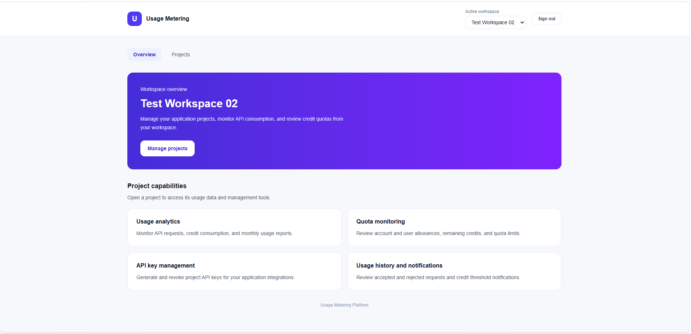
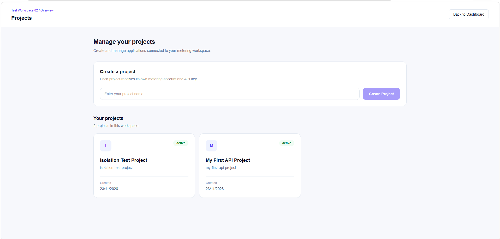
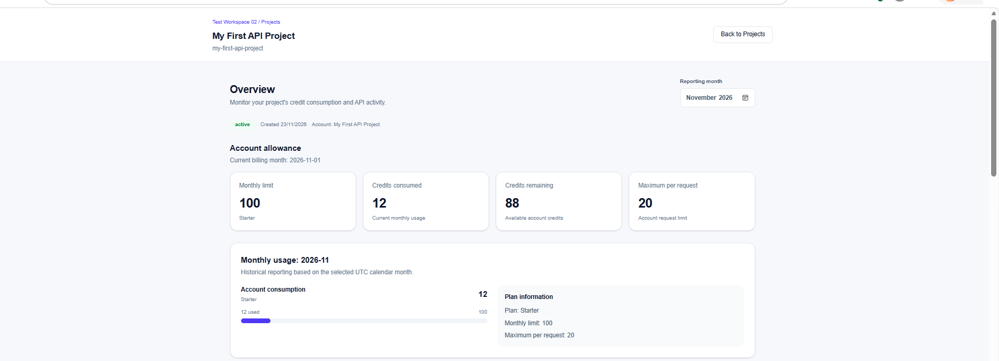
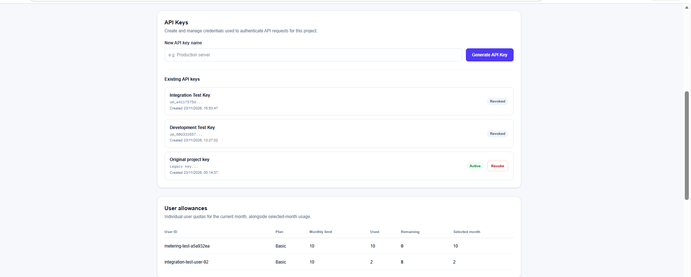
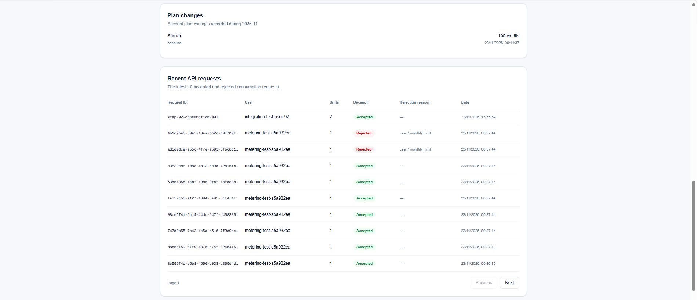
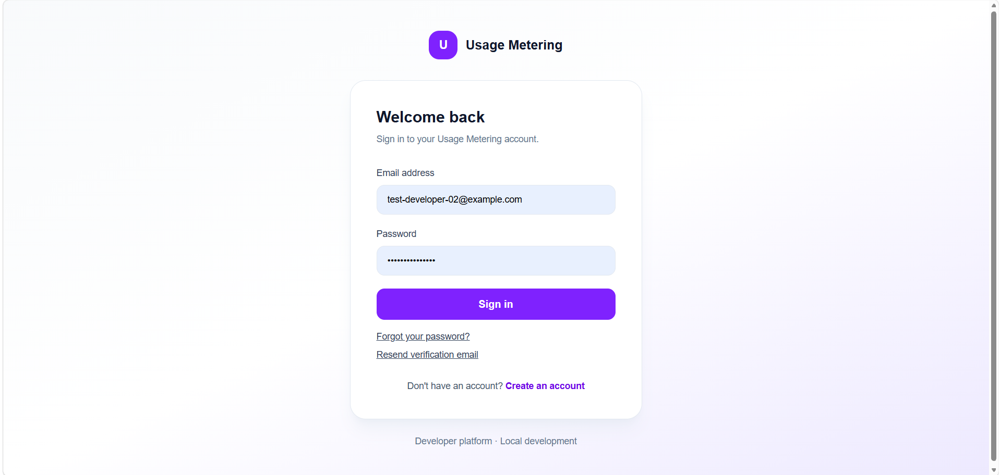
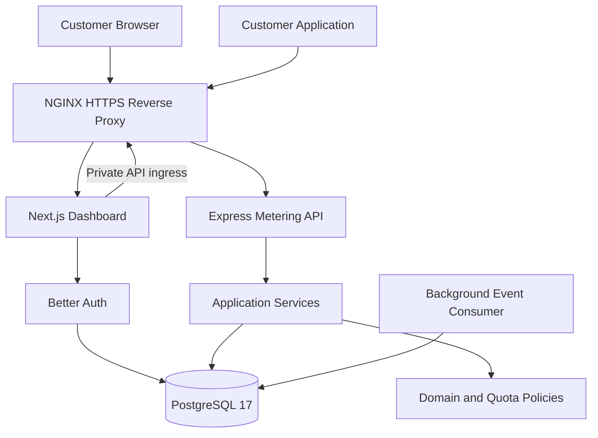
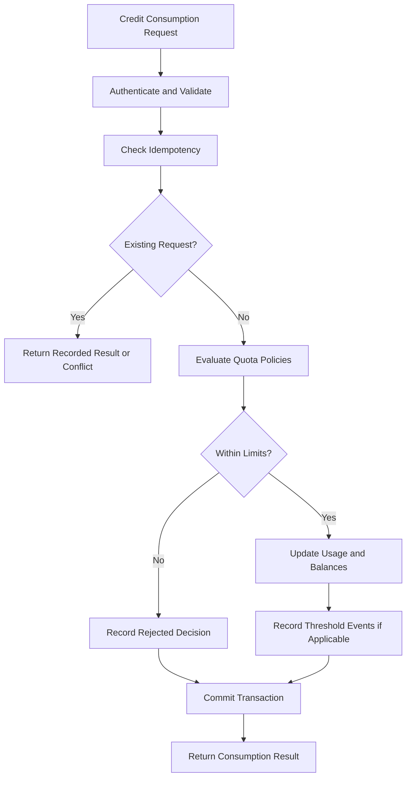

# Usage Metering and Quota Service


A full-stack, multi-tenant SaaS platform for application usage
metering, credit management, quota enforcement and consumption
analytics.

Designed for developers and software businesses that need to
control resource consumption, enforce usage-based plans and
provide customers with visibility into their remaining allowances.

## Project Overview

The platform combines a customer-facing management dashboard
with a dedicated metering API and transactional event processing.

Applications can integrate with the metering API to record
credit consumption, enforce account and user limits, prevent
duplicate charges and retrieve historical usage information.

Customers can manage organizations, projects and API keys
through an authenticated web interface.

## Product Screenshots

Actual application screenshots captured from the local
development environment using demonstration data.

### Workspace Overview



### Project Management



### Usage Analytics and Quota Monitoring



<details>
<summary>View additional application screenshots</summary>

### API Key Management and User Allowances



### Plan Changes and Usage History



### Low-Credit Notifications


### Customer Authentication



</details>

## Engineering Highlights

| Metric | Result |
|---|---:|
| Automated regression tests passed | 495 |
| Backend unit tests | 322 |
| Backend integration tests | 59 |
| Browser end-to-end tests | 114 |
| Final push, PR and post-merge CI checks | 9/9 |
| Tracked database migrations | 11 |
| Documentation files reviewed at project closure | 22 |
| Documentation references validated | 88 |
| Production rehearsal container health checks | 5/5 |
| Production rehearsal HTTPS checks | 4/4 |

These figures describe the completed engineering baseline
verified on 28 November 2026.

## Core Capabilities

### Customer Management

- Customer registration and email verification.
- Secure authentication and password recovery.
- Organization and workspace management.
- Tenant-isolated project management.
- Project API key generation and revocation.
- Authenticated customer dashboards.

### Usage Metering and Quotas

- Account-level and user-level quota enforcement.
- Predefined and custom usage plans.
- Per-request and monthly consumption limits.
- Atomic credit consumption.
- Account-scoped idempotency.
- Concurrency-safe quota enforcement.
- Monthly allowance and balance tracking.
- Historical plan limit preservation.

### Analytics and Event Processing

- Usage history and monthly reporting.
- Project-level consumption dashboards.
- Low-credit threshold notifications.
- Transactional event outbox.
- Background event processing.
- Retry scheduling and processing lease recovery.
- Consumer health and backlog monitoring.

## System Architecture

The application separates customer management, metering
business logic, persistent storage and background processing.



The diagram represents the locally rehearsed production
architecture. Development environments use a simpler
configuration.

### Credit Consumption Flow



The consumption transaction coordinates quota decisions,
usage accounting, idempotency records and applicable
notification events.

See the [system architecture guide](docs/architecture.md)
for implementation details and design tradeoffs.

## Technology Stack

| Layer | Technology |
|---|---|
| Backend | Node.js 22, TypeScript, Express |
| Frontend | Next.js 16, React 19 |
| Database | PostgreSQL 17 |
| Database access | Prisma and PostgreSQL clients |
| Authentication | Better Auth |
| Reverse proxy | NGINX |
| Infrastructure | Docker and Docker Compose |
| Browser testing | Playwright |
| Backend testing | Node.js test runner |
| Continuous integration | GitHub Actions |
| Local email testing | Mailpit |

## Repository Structure

```text
usage-metering-service/
├── src/
│   ├── api/              HTTP routes and middleware
│   ├── application/      Application services
│   ├── domain/           Business entities and policies
│   └── infrastructure/   Database, events and logging
├── web/                  Next.js customer dashboard
├── sql/                  Tracked database migrations
├── scripts/              Migration and operational tooling
├── deploy/               Production rehearsal configuration
├── docs/                 Technical and customer documentation
├── results/              Historical performance results
└── .github/workflows/    Automated CI workflows
```

## Getting Started

### Prerequisites

- Git
- Node.js 22
- npm
- Docker with Docker Compose

### 1. Clone the Repository

```bash
git clone https://github.com/naim-eng/usage-metering-service.git
cd usage-metering-service
```

### 2. Configure the Environment

Follow the [installation guide](docs/installation.md)
to configure database credentials, application secrets,
authentication and local email delivery.

Do not use production credentials in development environments
or commit environment files containing secrets.

### 3. Start the Backend

```bash
docker compose up -d --build db api consumer
```

### 4. Verify Backend Availability

```bash
curl http://localhost:3000/health
curl http://localhost:3000/ready
```

### 5. Start Local Email Testing

```bash
docker compose -f docker-compose.mail.yml up -d
```

Mailpit provides a local inbox for verification and password
recovery messages.

### 6. Start the Frontend

After completing the frontend environment configuration:

```bash
cd web
npm ci
npm run dev -- --port 3002
```

### Local Service Addresses

| Service | Address |
|---|---|
| Customer dashboard | http://localhost:3002 |
| Metering API | http://localhost:3000 |
| API health | http://localhost:3000/health |
| API readiness | http://localhost:3000/ready |
| Local email inbox | http://localhost:8025 |

For complete setup instructions, troubleshooting and safe
shutdown procedures, consult the
[installation guide](docs/installation.md).

## API Integration

Customer applications integrate with the metering service
using project API keys.

A typical integration involves:

1. Registering a customer account.
2. Creating an organization and project.
3. Generating a project API key.
4. Configuring usage plans and users.
5. Submitting authenticated credit consumption requests.
6. Reusing request identifiers when retrying operations.
7. Retrieving usage history and remaining allowances.

The [customer API integration guide](docs/customer-api-guide.md)
contains endpoint references, authentication requirements,
request examples and error handling instructions.

### Example: Consume Credits

After creating a project, obtaining an API key and registering
a metered user, set the METERING_API_KEY environment
variable securely and submit a consumption request:

```bash
curl -X POST http://localhost:3000/consume \
  -H "Content-Type: application/json" \
  -H "X-API-Key: ${METERING_API_KEY}" \
  -d '{
    "userId": "customer-123",
    "units": 2,
    "requestId": "operation-unique-001"
  }'
```

The service evaluates account and user quotas before recording
the consumption decision.

Reuse the same request identifier and payload when retrying
the same logical operation to prevent duplicate consumption.
Use a new request identifier for each new operation.

Keep API keys server-side and never expose them in browser
code or public repositories.

### Customer API Endpoints

| Method | Endpoint | Purpose |
|---|---|---|
| POST | `/users` | Register a metered user |
| POST | `/consume` | Consume credits |
| GET | `/account` | Account allowances |
| GET | `/users` | User allowances |
| GET | `/usage/history` | Usage history |
| GET | `/usage/monthly` | Monthly reporting |
| GET | `/notifications` | Low-credit notifications |
| GET | `/plans/custom` | List custom plans |
| POST | `/plans` | Create a custom plan |
| PATCH | `/plans/:planId` | Update a custom plan |
| PATCH | `/accounts/plan` | Change account plan |
| PATCH | `/users/plan` | Change user plan |

## Security and Reliability

The platform includes the following safeguards:

| Area | Implemented Controls |
|---|---|
| Authentication | Email verification, password recovery and session controls |
| Authorization | Organization membership and project access checks |
| Tenant isolation | Scoped customer data and API access |
| API credentials | Project API key management and revocation |
| Request security | Input validation, request limits and rate limiting |
| Data integrity | Database transactions and atomic usage updates |
| Concurrency | Account serialization and conditional balance updates |
| Idempotency | Duplicate consumption prevention |
| Event reliability | Transactional outbox, retries and processing leases |
| Infrastructure | HTTPS, database TLS and network separation |
| Operational security | Credential protection and structured log redaction |

These controls have been tested within the documented local
and automated regression environments. They do not constitute
an independent security certification.

## Testing and Continuous Integration

The final local regression baseline contains:

| Test Suite | Passed |
|---|---:|
| Backend unit tests | 322/322 |
| Backend integration tests | 59/59 |
| Frontend browser tests | 114/114 |
| **Total** | **495/495** |

GitHub Actions verifies backend type safety, automated backend
tests, frontend checks and browser end-to-end tests.

The final feature branch, pull request and post-merge CI runs
all completed successfully.

- [Final merged pull request](https://github.com/naim-eng/usage-metering-service/pull/2)
- [Final main branch CI run](https://github.com/naim-eng/usage-metering-service/actions/runs/46138849398)
- [Security regression documentation](docs/security-regression-summary.md)
- [Historical performance benchmarks](results/load-test-results.md)

## Production Deployment Preparation

A local production deployment rehearsal was completed using
hardened application containers, HTTPS ingress and PostgreSQL
TLS connections.

Validated procedures include:

- Application container builds and health checks.
- HTTPS reverse proxy configuration.
- Database certificate and hostname verification.
- Application network isolation.
- Tracked database migration execution.
- Database backup and restoration.
- Application image rollback.
- Consumer heartbeat and event backlog monitoring.
- Controlled operational failure detection.

The production rehearsal is not a public deployment.

See the [deployment readiness assessment](docs/deployment-readiness.md)
for outstanding requirements before operating with real
customer traffic.

## Documentation

### Getting Started and Customer Guides

| Guide | Description |
|---|---|
| [Installation](docs/installation.md) | Local setup and configuration |
| [Customer user guide](docs/customer-user-guide.md) | Customer onboarding and dashboard usage |
| [Customer API guide](docs/customer-api-guide.md) | API integration and endpoint reference |
| [Frontend guide](web/README.md) | Dashboard development |

### Architecture and Engineering

| Guide | Description |
|---|---|
| [System architecture](docs/architecture.md) | Components, design and tradeoffs |
| [Database guide](docs/database.md) | Database schema and migrations |
| [Developer guide](docs/developer-guide.md) | Development and testing workflows |
| [Technical reference](docs/technical-reference.md) | Detailed implementation reference |
| [Performance results](results/load-test-results.md) | Historical benchmarks |

### Security

| Guide | Description |
|---|---|
| [Authentication security](docs/authentication-security.md) | Authentication and access controls |
| [Environment security](docs/environment-security.md) | Configuration and secret management |
| [Production ingress](docs/production-ingress.md) | Deployment security requirements |
| [Security regression](docs/security-regression-summary.md) | Security verification |

### Deployment and Operations

| Guide | Description |
|---|---|
| [Deployment guide](docs/deployment-guide.md) | Production deployment preparation |
| [Deployment readiness](docs/deployment-readiness.md) | Validated controls and remaining requirements |
| [Production rehearsal](docs/production-rehearsal.md) | Local infrastructure validation |
| [Operations guide](docs/operations-guide.md) | Maintenance and troubleshooting |
| [Consumer operations](docs/consumer-operations.md) | Background event processing |
| [Production monitoring](docs/production-monitoring.md) | Health and backlog monitoring |
| [Database deployment](docs/database-deployment.md) | Safe migration procedures |
| [Database recovery](docs/database-recovery.md) | Backup and restoration |
| [Deployment rollback](docs/deployment-rollback.md) | Application rollback procedures |

### Project Assessment

| Guide | Description |
|---|---|
| [Project completion](docs/project-completion.md) | Final assessment, limitations and roadmap |

## Current Project Status

The planned engineering scope was completed on
28 November 2026.

| Area | Status |
|---|---|
| Core backend | Implemented |
| Customer dashboard | Implemented |
| Authentication and tenant isolation | Implemented and tested |
| Automated regression testing | Passed |
| Documentation | Completed |
| Local production rehearsal | Completed |
| GitHub integration | Merged into main |
| Public deployment | Not performed |
| Commercial billing | Not implemented |

## Future Development

Potential future development includes:

- Subscription billing and payment integration.
- Expanded customer team administration.
- External notification delivery and webhooks.
- Distributed rate limiting and horizontal scaling.
- Production-scale performance validation.
- Least-privilege production database identities.
- Encrypted off-site backups and external alerting.
- Public hosting, production email and customer onboarding.

These capabilities are outside the completed local
engineering scope.

## Licensing

Public repository access does not by itself grant permission
to reuse, redistribute or commercialize the software.
Applicable licensing and ownership rights must be confirmed
before external distribution or commercial use.
